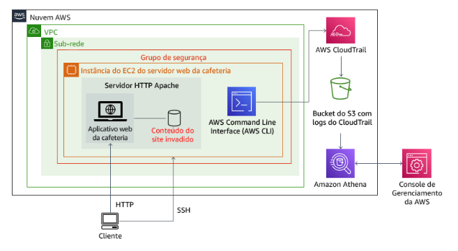
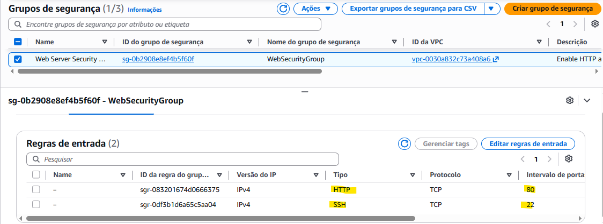
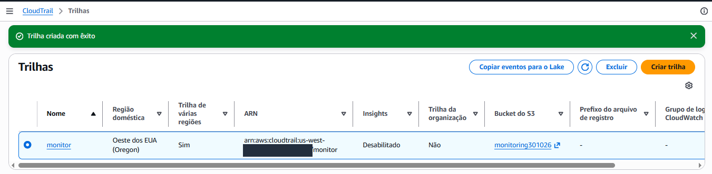
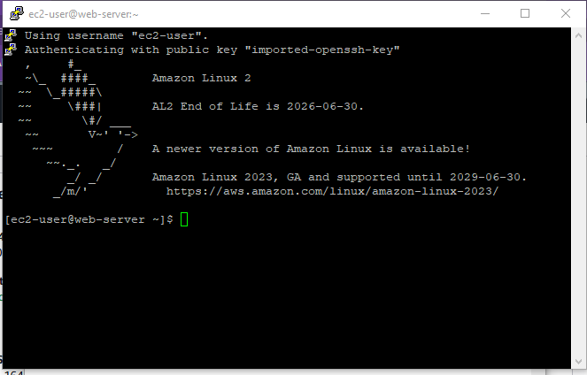
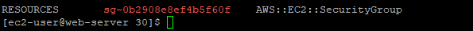
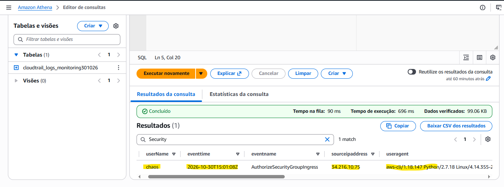
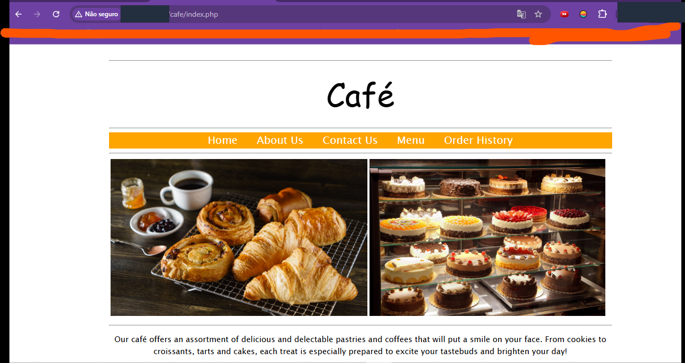

<div align="center">

# 🕵️‍♀️☕ Caso do Café Invadido
### Investigação de incidente na AWS com CloudTrail, Athena e AWS CLI


**Alguém trocou a foto das delícias da cafeteria por uma imagem esquisita. Quem foi? Vamos descobrir!** 🔍

</div>

---

## 🎬 A história

A cafeteria **Café** tem um site simples rodando em uma instância EC2. Tudo ia bem, até que, logo depois de ativar o **CloudTrail**, o site foi **invadido** 😱

Neste laboratório eu fiz o papel de detetive da nuvem: ativei a auditoria, caçei pistas nos logs, descobri o culpado, **expulsei o invasor**, **restaurei o site** e **fechei as brechas de segurança**.



---

## 🧰 Ferramentas usadas

| 🧩 Serviço / Ferramenta | 🎯 Para que serviu |
|---|---|
| 🖥️ **Amazon EC2** | Servidor web da cafeteria (Apache) |
| 🛡️ **Security Group** | Firewall da instância (regras HTTP e SSH) |
| 📜 **AWS CloudTrail** | Registrar tudo o que acontece na conta |
| 📦 **Amazon S3** | Guardar os arquivos de log do CloudTrail |
| 🔎 **Amazon Athena** | Consultar os logs com SQL |
| ⌨️ **AWS CLI** | Buscar eventos com `lookup-events` |
| 🔐 **PuTTY / SSH** | Acessar a instância |
| 👤 **AWS IAM** | Remover o usuário do invasor |

---

## 🚀 Passo a passo

### 1️⃣ Fechando a porta (só para mim) 🚪

No grupo de segurança do **Café Web Server**, adicionei uma regra de entrada **SSH (porta 22)** com origem **My IP** (terminando em `/32`), nunca `0.0.0.0/0`. Depois abri o site em `http://<WebServerIP>/cafe/` para ver que estava tudo normal.



---

### 2️⃣ Ligando as câmeras de segurança 🎥

Criei uma trilha no **CloudTrail**:

- 📛 Nome: `monitor`
- 📦 Bucket S3 novo: `monitoring####`
- 🔑 Alias do KMS: iniciais + `-KMS`



Pouco depois, o site foi **invadido**. E, no grupo de segurança, apareceu uma regra extra de **SSH aberta para o mundo (`0.0.0.0/0`)** que eu não tinha criado 👀

---

### 3️⃣ Conectando na instância 🔐

Usei o **PuTTY** com o usuário `ec2-user` e a chave `labsuser.ppk` (em *Connection > SSH > Auth > Credentials*).



---

### 4️⃣ Baixando e lendo os logs 📦

```bash
mkdir ctraillogs
cd ctraillogs
aws s3 ls
aws s3 cp s3://<monitoring####>/ . --recursive
```

Os logs vêm compactados em `AWSLogs/<conta>/CloudTrail/<regiao>/<ano>/<mes>/<dia>`. Descompactei e formatei o JSON para ficar legível:

```bash
gunzip *.gz
cat <arquivo>.json | python -m json.tool
```

Filtrei com `grep` para ver IPs de origem e nomes de eventos:

```bash
for i in $(ls); do echo $i && cat $i | python -m json.tool | grep sourceIPAddress ; done
for i in $(ls); do echo $i && cat $i | python -m json.tool | grep eventName ; done
```

---

### 5️⃣ Investigando com a AWS CLI 🧐

```bash
aws cloudtrail lookup-events --lookup-attributes AttributeKey=EventName,AttributeValue=ConsoleLogin

region=$(curl http://169.254.169.254/latest/dynamic/instance-identity/document|grep region | cut -d '"' -f4)
sgId=$(aws ec2 describe-instances --filters "Name=tag:Name,Values='Cafe Web Server'" --query 'Reservations[*].Instances[*].SecurityGroups[*].[GroupId]' --region $region --output text)
echo $sgId

aws cloudtrail lookup-events --lookup-attributes AttributeKey=ResourceType,AttributeValue=AWS::EC2::SecurityGroup --region $region --output text | grep $sgId
```



---

### 6️⃣ Chamando o Athena para o caso 🧠

Criei a tabela do Athena a partir do histórico de eventos do CloudTrail, apontei o resultado das consultas para `s3://monitoring####/results/` e rodei SQL nos logs:

```sql
SELECT useridentity.userName, eventtime, eventname, sourceipaddress, useragent, requestparameters
FROM cloudtrail_logs_monitoring####
WHERE eventsource = 'ec2.amazonaws.com'
  AND eventname = 'AuthorizeSecurityGroupIngress'
ORDER BY eventtime;
```



---

## 🚨 Caso resolvido: o culpado é...

| 🔎 Pergunta | 🧾 Resposta |
|---|---|
| 👤 Quem abriu a brecha? | **`chaos`** |
| 🕐 Quando? | **2026-10-30T15:01:08Z** |
| 🌐 De qual IP? | **34.216.10.75** |
| ⚙️ Como? | **Programático** (`aws-cli/1.18.147 Python/2.7.18`) |
| 💥 O que fez? | `AuthorizeSecurityGroupIngress` (SSH aberto para `0.0.0.0/0`) |

---

## 🧹 Faxina e blindagem

### 👢 Expulsando o invasor do sistema operacional

```bash
sudo aureport --auth
who
sudo userdel -r chaos-user      # falha: o usuário ainda está logado
sudo kill -9 <ProcNum>          # encerra a sessão dele
who
sudo userdel -r chaos-user      # agora funciona
sudo cat /etc/passwd | grep -v nologin
```

### 🔒 Reforçando o SSH

O arquivo `/etc/ssh/sshd_config` tinha sido alterado para permitir **login por senha**. Corrigi:

```bash
sudo vi /etc/ssh/sshd_config
# comentar:     PasswordAuthentication yes
# descomentar:  PasswordAuthentication no
sudo service sshd restart
```

Depois, **apaguei do grupo de segurança** a regra SSH `0.0.0.0/0` criada pelo invasor.

### 🖼️ Restaurando o site

```bash
cd /var/www/html/cafe/images/
ls -l
sudo mv Coffee-and-Pastries.backup Coffee-and-Pastries.jpg
```



### 🗑️ Removendo o usuário do IAM

No **IAM > Usuários**, excluí o usuário **`chaos`**. Fim de papo! 👋

---

## 💡 O que eu aprendi

- 📜 O **CloudTrail** registra quem fez o quê, quando e de onde. Ligue **antes** de precisar!
- 🔎 O **Athena** transforma logs gigantes em respostas rápidas com SQL.
- 🕵️ O campo **`useragent`** mostra se a ação veio do console ou da CLI/SDK.
- 🚪 Nunca abra a porta 22 para `0.0.0.0/0`. Use **My IP (`/32`)**.
- 🔑 Desative o **login por senha** no SSH e use pares de chaves.
- 🧾 Auditar logs é parte do trabalho de quem cuida de dados e infraestrutura.

---

## 🗂️ Estrutura do repositório

```
📦 aws-lab-cloudtrail-athena-investigacao-invasao
 ┣ 📄 README.md
 ┗ 📁 imagens
    ┣ 🖼️ 00-arquitetura-do-lab.png
    ┣ 🖼️ 01-regra-ssh-meu-ip.png
    ┣ 🖼️ 02-cloudtrail-trilha-monitor.png
    ┣ 🖼️ 03-cloudtrail-lookup-events-sg.png
    ┣ 🖼️ 04-athena-identificacao-invasor.png
    ┣ 🖼️ 05-site-cafe-restaurado.png
    ┗ 🖼️ 06-conexao-putty.png
```

---

## 👩‍💻 Autora

<div align="center">

**LUCIANA RB DE ASSIS**

[](https://www.linkedin.com/in/lucianarbassis/)
[](https://github.com/alra-code)

☁️ *Construindo minha jornada em Dados e Nuvem, um laboratório de cada vez.* ✨

</div>
